# Examples

Paste any of these into the plugin to see what it draws.

## Tab

- Tab is written the way you'd find it online: one line per string, with fret numbers on hyphen-filled lines.
- Spacing is tidied up for you, so you don't have to count hyphens.

**Input**

```
e|-3-2--9-------12-
B|-3-3--9-------10-
G|-0-2--10---------
D|-0-0--11---------
A|-2----11--7------
E|-3----9---5------
```

**Rendered**

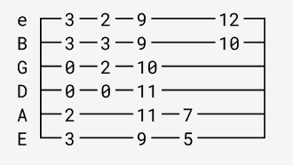

### String tuning

If you omit string names, the plugin assumes that you're in standard tuning.

**Input**

```
|-0-1-1-|
|-1-1-3-|
|-2-2-3-|
|-3-3-3-|
|-0-3-1-|
|---1---|
```

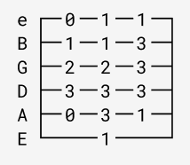

You can provide alternate tunings.

**Input**

```
D |-0-5-7-|
A |-0-5-7-|
F#|-0-5-7-|
D |-0-5-7-|
A |-0-5-7-|
D |-0-5-7-|
```

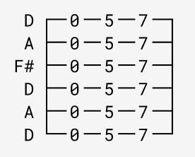

You can also provide 4- and 7-string tabs.

**Input**

```
|---------|-----------|
|---------|-----------|
|---------|---------0-|
|-0-0-0-0-|-0-0-3-0---|
```

**Rendered**

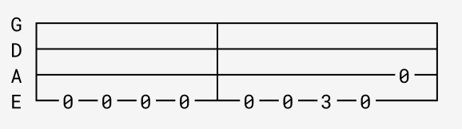

### Measure lines

- A `|` across every string draws a measure line.
- The ones at the start and end of each line are optional: every row gets them anyway.

**Input**

```
e|-------------|---------------------------------|
B|-0---1---3---|-12---12----12---12---12----12---|
G|---0---0---0-|----0----------0----0----------0-|
D|-------------|---------------------------------|
A|-----0---2---|-10------10------10------10------|
E|-3-----------|---------------------------------|
```

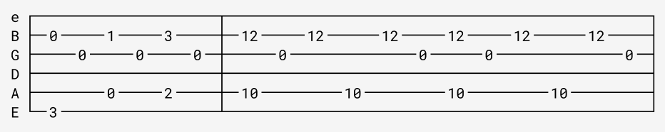

### Techniques and muted notes

Letters and symbols next to a fret number, like the `h` in `5h7` or the `/` in `5/7`, are drawn as written, right beside the number.
An `x` marks a muted note.

**Input**

```
|---------------------------|-----------------------------|
|---------------------------|---x-x-------12--------------|
|--------9-9----9------9----|---x-x-11/13----13/11p9------|
|---9----9-9h11-9------9h11-|---x-x------------------11p9-|
|---9h11----------9-12------|-----------------------------|
|-0-------------------------|-0---------------------------|
```

**Rendered**

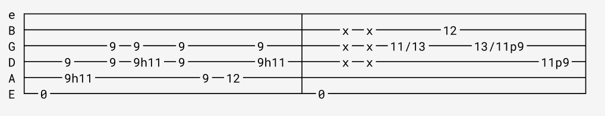

### Multiple rows

A blank line starts a new row, so a long riff can wrap over several lines.

**Input**

```
e|-------------------|-------------------|----------------------|---------------|
B|-------------------|-------------------|----------------------|---------------|
G|-------------------|-------------------|----------------------|---------------|
D|-----------------2-|-----------------2-|-2------------------2-|-2-------------|
A|-----/7----------2-|-/7--------------2-|-2--/7--------------2-|-2--/7---------|
E|-0-0----6--5-0-0-0-|-----6--5--------0-|-0------6--5--------0-|-0------6--5---|

e|-----------------|-------------------|
B|-----------------|-------------------|
G|-----------------|-------------------|
D|-----------------|-------------------|
A|-2-------------3-|-2---------------3-|
E|-0-0-0-0-0-0-0-1-|-0-0-0-0-0-0-0-0-1-|
```

**Rendered**

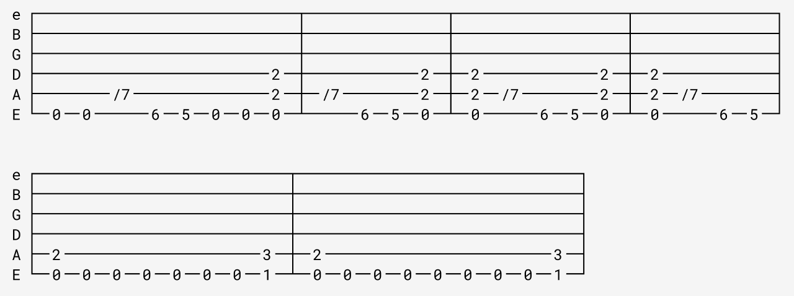

## Fretboard

A fretboard diagram is written one line per string, listing the frets to mark on that string, separated by spaces.
A `0` marks an open string, an `x` marks a muted one, and an empty line leaves a string with nothing on it.

The plugin works out which frets to draw from the frets you name, leaving one empty fret either side.
When the shape is within a fret of the nut, the diagram starts at the nut.
Further up the neck it starts just below the shape, and the fret numbers show where you are.
**Frets before** and **Frets after** under **Options** change how much room the shape gets.

### Open E major chord

**Input**

```
0
0
1
2
2
0
```

**Rendered**

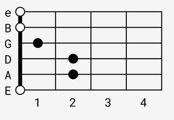

### Open D major chord

The two lowest strings aren't played, so they're marked `x`.

**Input**

```
2
3
2
0
x
x
```

**Rendered**

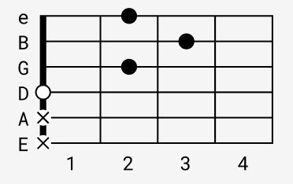

### G major scale, 2nd position

Rooted on the 3rd fret of the low E string.
The shape sits within a fret of the nut, so the diagram starts there and shows frets 1 to 6.

**Input**

```
2 3
3 5
2 4 5
2 4 5
2 3 5
3 5
```

**Rendered**

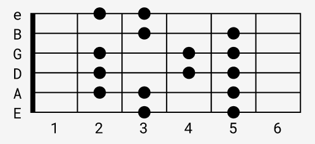

### B major scale, 6th position

The same shape as the G major scale, moved up four frets, so it's rooted on the 7th fret of the low E string.
The diagram starts at the 5th fret and shows frets 5 to 10, with no nut.

**Input**

```
6 7
7 9
6 8 9
6 8 9
6 7 9
7 9
```

**Rendered**

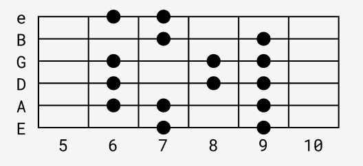
